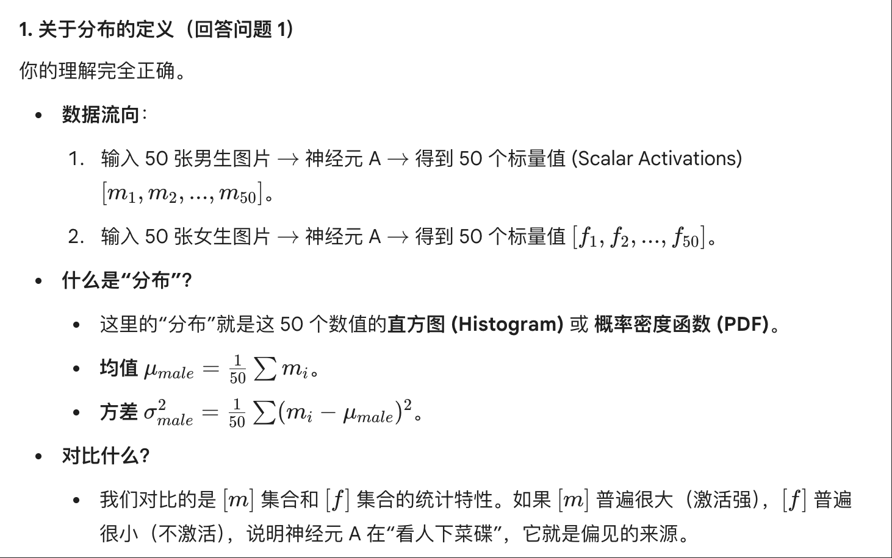
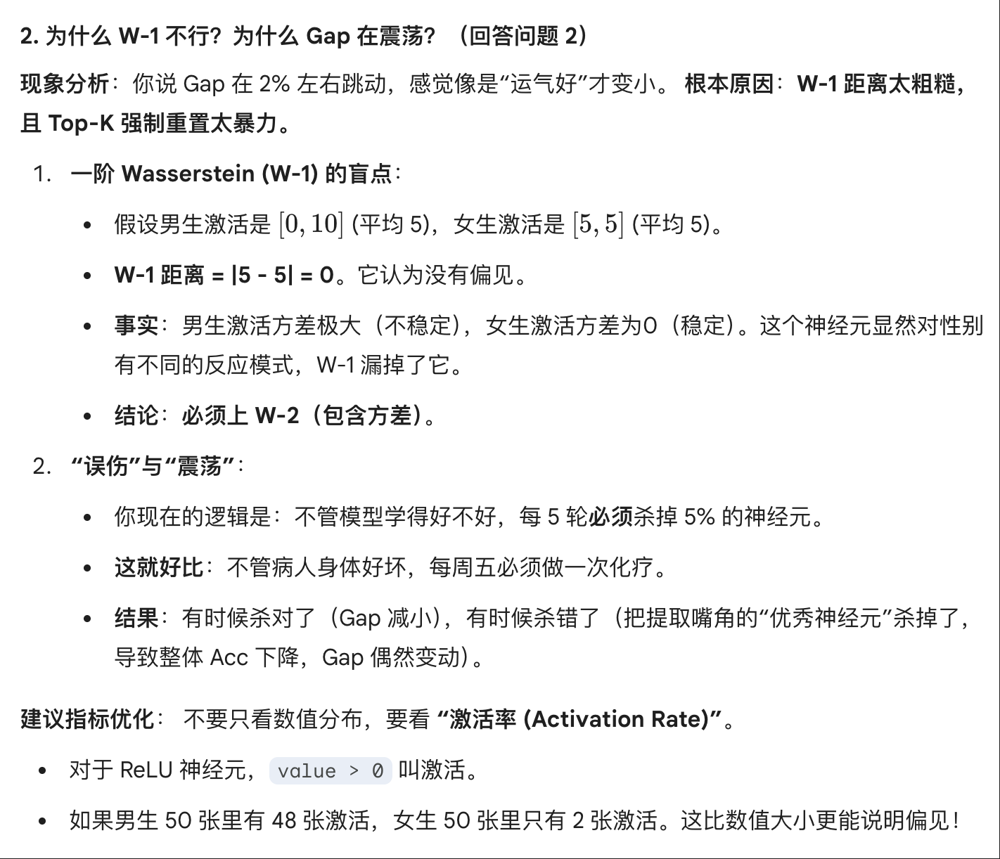
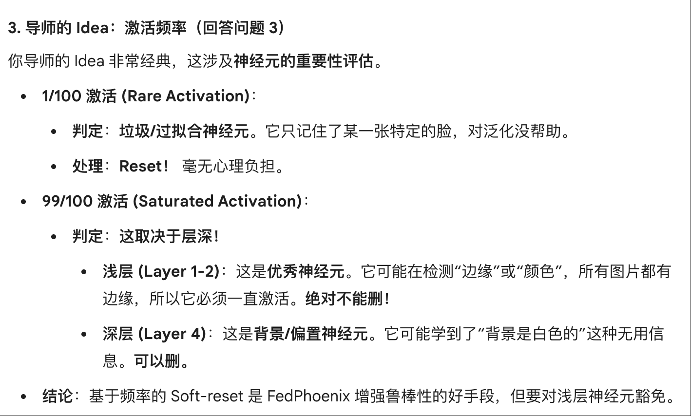
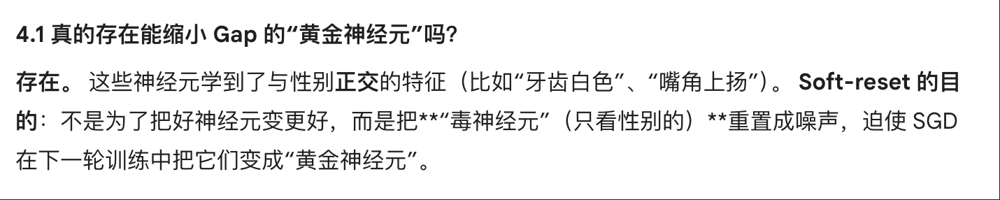
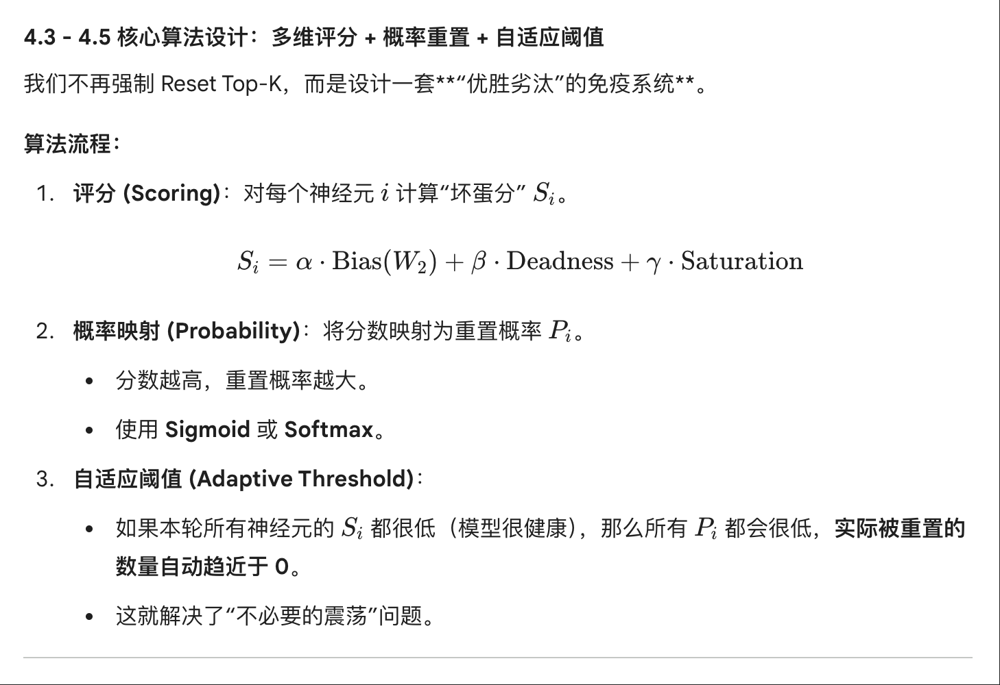

# FedFAAR

这是一个研究联邦公平性的框架

## idea 1.0

在联邦学习中，利用各客户端激活值的变化模式区分“共性学习方向”和“受敏感属性影响的差异方向”，通过周期性地对这些差异化激活进行归一化或重置操作，削弱因性别、肤色等非任务因素引入的偏差，从而让模型更关注任务本身的因果特征（如“是否微笑”），实现同时提升泛化性与公平性的目标

## idea 2.0 - 12.17

1. **这里的均值和方差是来自于哪个分布？**
   **对于某单个神经元A，我想要的是根据探针数据集（假设100张图片50男50女），50男生输入model，对应的神经元A的五十次反馈情况，或未激活，或激活，激活值为多少做一个分布。另外50女生图像输入同理。 对应比较男生和女生图像输入的激活值分布的差异，如果差异过大，则可以考虑重置掉这部分神经元。**

   

   

   

2. **但是如何量化表示这样的差异是我现在疑惑的，你说的二阶 Wasserstein可以满足我的需求吗？我的目的是削减掉学习到差异特征的神经元。但是根据我现在的实验结果。female的准确率在93%附近摆动 male的准确率在91%附近摆动 按照一阶 Wassersteinreset每5n+2轮执行reset操作，总会造成干扰，有时候female的acc被reset掉到92% gap因此缩小进了2%，但是实际上并没有有效合理的缩小gap，因为学习了若干轮之后female还是在93-92的幅度内跳动 male在91-90的幅度内跳动。如果female正好到了92 male到了91，那么gap就幸运的小一些，否则就变大。这不是我想要的情况。**
   **是不是我的reset操作误伤到了太多的神经元？还是说我的faar无法帮助model学习更进一步？你觉得使用male和female的probe探针获取到的数据以“分布”的形式比较真的合适吗？还是说单纯以所有激活值的累加的差、还是激活/非激活的数量直接对比会更合适？**

   

   

   
   
   
   

3. **另外有一点，是我们导师给出的idea：对于某个client的某个神经元B，如果输入探针probe中的100张图片，这个神经元只对其中一张有激活的反馈，那么说明这个神经元学到了机器偏置的特征，重置掉对model的整体性能影响不大。 如果这个神经元对全部一百张都激活，或者激活了99张，说明这个神经元学到的知识效用不大。（对于这一点我有点疑惑）。整体的思路被我成为基于“客户端频率”指标做出的soft-rest。**

   

   

   

4. **对于1.和2. 归属于我的faar方法中的fairness板块，你需要从探针、诊断、治疗三个维度给我帮助。 对于3. 归属于我的faar方法的base Fedphoenix板块，这是对于其中的随机reset的进一步思考。 但是整体来看的话，我需要思考下面的问题：**

   1. **对于整个model来说 一个整体acc在91-92% male在91% female在93%的稳定model来说，是否存在这样的一些神经元，我对他们进行soft-reset操作之后，会把model整体从收敛的状态往回来，进一步多学习几个round之后能够在不影响甚至提高整体acc的情况下，缩小female和male之间的差距？**
      A:

      

      

   2. **如果对于一种数据分布情况和联邦学习方法来说，female的acc一直以2%高于male，我有没有可能打破这2%的差距，让全局acc不变的情况下，male的acc反超female？**
      A:

      
      
      
      

   3. **如果4.1是正确的，那么我这些神经元如何描述？ 这些神经元是否满足我前面的1.和4.中的描述？ 我对1.和3.的描述的神经元群体中，是否有包含了“无辜神经元”甚至“优秀神经元”？ 那么在一个model中 神经元对整体性能的贡献如何判断？**

      

   4. **如果延伸4.3 的想法，我在1.和3.中的描述都包括了部分异常神经元，但是也囊括了更多无辜神经元的话，我是否可以做一个二元判断。只有1.和3.指标综合都比较高的神经元，才更会被reset？ 同时我们无法肯定前文的描述一定准确，所以借鉴Fedphoenix的思路，采取概率reset，对于1.和3.指标很高的神经元 在每一或者没几轮的学习之前soft-reset掉，强迫模型学习更鲁棒的特征，去SGD寻找更优质的解。而对于普通神经元，同时也有可能被选中，进行soft-reset操作，只是概率会比较小。这个概率分布设定一定不是线性的，可以通过softmax函数来实现。**

      

   5. **是否可能会出现这种情况：当某一轮的soft-reset之后，所有神经元都非常健康，在之后的20轮内可能不进行任何干预才是最好的学习路径，但是我们每隔一定轮次都强制干预了固定数量的神经元，尽管会有退火机制，但是如果这一轮要刷掉200个神经元的话，不管神经元的整体生长环境如何都要强制执行。 这是不是并不理智？会造成不必要的震荡。有没有方法锁定这种全局健康生长的情况并做出一些改变？**
      A:

      

## Conference 12.17周三下午

* 检查了几次实验结果，female和male的gap并不大

  

* 数据集问题

## Conference 12.19周五下午

* 成功locate问题，即M_S和M_NS的不公平性

## 12.21周天上午工作总结：
我必须要系统性的和你说明一下我的思路和目前的工作内容进展：

1. 研究问题：我们研究的是联邦公平性问题，定位的是，使用celeba数据集 在20个client每个client有1000个数据 1-4client有200male 20%smile  800female 80%smile 5-20client有800male 20%smile 200female 80%smile的场景下，虽然fedavg最后可以收敛 且male和female整体的accgap在1-3%左右但是male组里面的male_smile_acc只有67%左右，这和male_nonsmile_acc相比形成了极大的不公平。

2. 实现背景：我的baseline是fedavg和Fedphoenix，后者是师兄的一篇A会。Fedphoenix中 每一轮client学习之前都会随机选取5%的神经元 执行soft-reset操作，结果是最后的鲁棒性和泛化性不错。我基于Fedphoenix来扩展思路，研究公平性。

3. 假设：在问题1中，我假设”偏见“在神经元中是稀疏分布的。即可以通过定位+修复的方式减少这种偏见。

假设：我的五种计算神经元可疑度的方法（在你的记忆里）可以把真正的偏见神经元囊括到。

假设：经过一段时间的学习，整体的可疑度应该是缓慢下降的，对应的直接指标就是hard组(male+smile)对应的acc从66%回升上去。我需要证明可疑度和male_acc_gap应该是正相关的。

4. 算法思路：

phase1 预测期 维持fedavg的思路

phase2 间歇性手术期 每个n轮执行一次核心算法faar

faar：

probe：在server段维护一个绝对公平的数据集，在这里数据在AAAFAAR/probe_balanced_2000.pt，维护4个小子组，每个500份。

Diagnose：对于某个神经元 计算其怀疑度的时候，把探针数据集中的数据全部输入一遍，得到男 女的激活值分布图P和Q 使用这两份数据分布和前面的五种locate函数来计算可疑度。于是可以得到每一个神经元基于probe的可疑度。

Treatment：由前面的可疑度对所有神经元做一个概率分布，可疑度高的被选中的几率高，再加一个温度机制保证可控，即可以退化成随机选择。对于选中的神经元，执行soft-reset操作（计算神经元所在的层的均值和方差，根据N(x,sigma)来软重置）或者执行手术操作，即对所在的神经元，目标是男女差异，执行loss上升的反学习，实现微小opreation。

和Fedphoenix的区别在于，treatment是在server端进行的，且是间隔n轮执行一次。

Gemini反思:
Server端手术的效果能否传递到 Client？ (Server 改好了，发给 Client 训练几轮，Client 本地的数据偏见太重，会不会瞬间把手术效果“洗回去”？即 Catastrophic Forgetting of Fairness)。

Masking (Reset) vs Operation (Unlearning) 的抉择？ (就像之前的实验，Reset 可能导致功能崩盘，Unlearning 参数太难调)。

Doubt Score 与 Acc 的相关性无法对齐？ (理论上怀疑度下降，Hard Acc 应该上升，但实际实验数据可能是一团乱麻，或者出现 Simpson 悖论)。

我现在在做实验验证前面的一个重要假设1：

偏见神经元是稀疏分布的，因此我才有机会locate+treatment去改变这种偏见。

我的实验2是这样的：我加载了一个fedavg在前面提到的client数据分布上，训练199轮（收敛）的ckpt，和celeba的test集合。调用五种locate方法和hard-mask（选中直接清空）机制来判断这假设是否成立。

如果mask掉之后male_gap下降 、M_S_acc上升且整体的global_acc下降幅度不大 那么就说明我定位到了偏见神经元存在、我的locate函数之一可以定位到偏见神经元、且这种偏见会导致我想要解决的公平性问题。

你提出的三个困难点非常值得思考，我们可以后续来研究。

我现在在做实验验证前面的一个重要假设1：

偏见神经元是稀疏分布的，因此我才有机会locate+treatment去改变这种偏见。

我的实验2是这样的：我加载了一个fedavg在前面提到的client数据分布上，训练199轮（收敛）的ckpt，和celeba的test集合。调用五种locate方法和hard-mask（选中直接清空）机制来判断这假设是否成立。

我是这样想的：如果mask掉之后male_gap下降 、M_S_acc上升且整体的global_acc下降幅度不大 那么就说明我定位到了偏见神经元存在、我的locate函数之一可以定位到偏见神经元、且这种偏见会导致我想要解决的公平性问题。

但是我做了两个理论上应该是相同的实验hypothesis02.py和hypothesis02_stable.py 里面我只是做了一些输出位置的调整 但是输出的结果完全不一样：

在同样处理conv3 mask比例是30% 方法是log_ood的时候，02输出的是：

✂️ [Mask] Pruned 19 neurons in conv3

log_odds     | 30%    | 19     | 80.05    | 2.40     | 71.01    |  +4.56%

02_stable输出的是：

✂️ [Mask] Pruned 19 neurons in conv3

log_odds   | 80.07    | 3.24     | 55.69 (-10.76%) | 93.08    | 74.55    | 90.04    | 78.08

前者让M_S_acc涨了 这是我想要的，但是涨的幅度不够。

后者M_S_acc居然跌了这么多，理论上两个应该是一样的才对！

这是我的02代码：

## 12.22 conference
经过开会讨论之后 我们有了不同的思路，可以试一试去发展：

我们的公平性问题需要去解决的事对于笑的情况下 男女的差异 以及不笑的情况下，男女的差异。

这就是说，我们想要消除的公平性问题是M_S & F_S 以及 M_NS & F_NS

1. 我们之前的在server端维护的probe数据集就因此有一些使用上的区别。现在要求：

把probe中的M_S F_S输入神经元，得到两个分布P Q，根据我们的locate函数计算出这个神经元的可疑度W。 同时，再把probe中的M_NS和F_NS输入神经元，得到两个分布P' Q'。根据我们的locate函数计算出对应的可疑度W' 最终取W和W'的最大值作为我们最终定位该神经元的可疑度W_0

2. 在server端，我们根据可疑度生成一个针对所有神经元soft-reset的概率分布，并设置tau温度稍微大一些，加入一定的随机扰动（贴合Fedphoenix）。但是server端从不使用soft-reset之后的model。我们想要的soft-reset只会发生在，在下一轮联邦学习的时候，比如有n个client，则serve根据model的可疑度概率分布reset n个model的模型传递给n个client。我对温度tau的要求就是，至少要保证这n个客户端接收到的model是互不相同的。之前设置为tau=1 不管reset多少次 效果都等于topK的硬选择。这对我们model的损伤很大。因为我们知道，纯粹的随机reset对model是有正向促进作用的。

## dataset

1. [CelebA](https://mmlab.ie.cuhk.edu.hk/projects/CelebA.html)